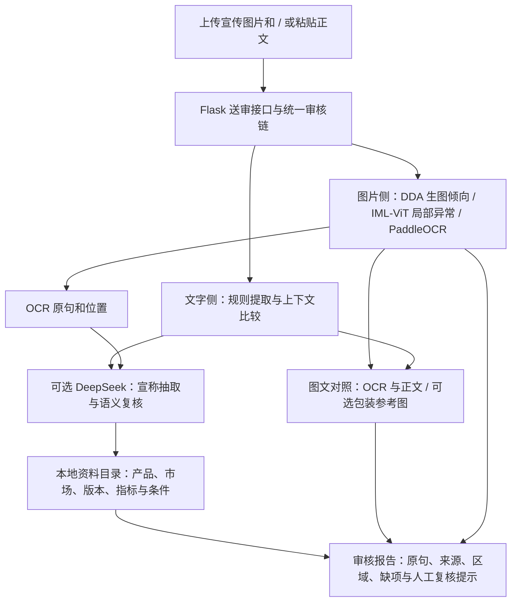

# BeautyProof · 美妆宣传审核台

BeautyProof 是一个面向美妆宣传内容的审核原型。审核员输入文字、图片或图文组合后，系统分别检查**文字宣称、图片线索和图文对应关系**，展示可回查的原句、图片区域和资料来源，辅助人工判断是否需要进一步核验。

项目的核心问题是：**宣传里具体说了什么，图片展示了什么，现有资料能否支持对应说法？** 产品也预留了面向消费者的肤质自测和产品资料对照。项目仍在开发中：当前结果是复核线索，不是自动认定内容真实、虚假、违法或适合所有人的依据。

> **接手者先看**：工作台、文字规则、DeepSeek 文本接口、本地图像模型适配、资料目录和肤质自测已经实现；图像检测的独立美妆盲测、模型正式微调、完整功效证据库及真实业务试用尚未完成。历史小样本结果和测试通过数均不能证明模型的泛化性能。

## 一分钟了解项目

| 部分 | 已实现 | 当前边界 |
|---|---|---|
| 文字审核 | 提取原句和部分产品、指标、数值、期限、色号；识别常见敏感词、否定、疑问，以及部分正文内部数值冲突。可选 DeepSeek 辅助抽取和语义复核。 | 复杂指代、讽刺、跨段语义和漏抽仍可能出错；模型建议需要人工核对。 |
| 图片审核 | 接入 DDA 整图生成倾向、IML-ViT 局部异常热力图和 PaddleOCR；同时保留哈希、C2PA 等辅助检查。 | 图片模型和权重需单独准备；分数未经当前美妆盲测校准，不是造假概率。异常不等于一定有害修图。 |
| 图文匹配 | 对可归属同一产品、指标和条件的正文与 OCR 宣称进行比对；可用自选包装参考图在本地定位相似图案；低置信度 OCR 可回到原图核对。 | 找不到参考图图案不代表商品不在图里；相似图案不能证明型号、真伪或功效。没有定位到的视觉内容无法被充分核验。 |
| 依据与知识库 | 本地资料目录区分品牌宣称、产品标签、功效试验和技术方法；引用保留来源、位置、市场及已记录的条件。 | 仓库首批为 **30 条品牌记录，涉及 20 个产品名称**，其中一些缺少试验细节；它们不是 30 条独立功效证明，也不是行业效果上限。 |
| 肤质与推荐 | 20 题自评，生成干性、油性、混合性、中性或暂难判断；档案保存在当前浏览器，可更新或清除。依据少量品牌资料给出最多 3 个候选。 | 自测不是诊断；现有推荐库只有 4 条候选，版本、成分和可购买情况仍需核对。填写避用成分但缺少完整成分表时不推荐。 |
| 训练与评测 | 提供按来源组划分、去重、标识检查、DDA 特征提取和分类头训练、校准与盲测工具。 | 训练流程已用合成特征验证，尚未用足够授权美妆数据完成正式微调和独立盲测。 |

## 为什么做这个项目

美妆种草可能同时包含产品功效、受试条件、前后对比图、图片文字和生成式视觉素材。即使图片经过 AI 生成或修图，也需要结合它被如何使用、是否披露，以及它是否被当作功效证据，才能判断宣传风险；真实照片同样不能自动证明功效。

因此，本项目把审核拆成三个问题：

1. **文字说了什么？** 是否包含功效承诺、绝对化表述、不同段落的矛盾或对试验条件的扩大？
2. **图片有哪些线索？** 整图生成倾向、局部编辑异常、图片上的文字及来源声明分别是什么？
3. **图文能否对应？** 能否确认同一产品、版本、指标和条件；图片是否展示了相关内容；已核验资料是否适用？

缺少图片、模型、明确版本或原始试验时，报告应说明缺项，而不是把“没有发现冲突”等同于“已证实”。

## 技术路线



### 图片侧

- **DDA**：调用官方 DDA / DINOv2 权重，输出整图 AI 生成倾向分及模型、权重哈希和预处理信息。未通过阈值校准与独立盲测前，分数只作复核线索。
- **IML-ViT**：定位可能的局部异常并生成叠加图，供审核员结合原图、编辑记录和素材用途判断。真实上妆、正常滤镜、压缩和局部修图不能只凭热力图区分。
- **PaddleOCR PP-OCRv5 mobile**：提取图片文字、坐标和置信度。低置信度文字保留在报告中供人工核查，不作为自动数值冲突的依据。
- **OpenCV 包装参考图定位**：可选上传已知包装或标签参考图，在宣传图中寻找相似平面图案；输出相似区域或“无法判断”。
- 图像检查逐项记录执行状态；模型不存在、内存不足或执行失败时，其余可用检查继续运行。

模型来源：[DDA 官方代码](https://github.com/roy-ch/Dual-Data-Alignment) · [DDA 官方权重](https://huggingface.co/Junwei-Xi/Dual-Data-Alignment) · [IML-ViT 官方代码](https://github.com/SunnyHaze/IML-ViT) · [PaddleOCR](https://github.com/PaddlePaddle/PaddleOCR)。第三方模型的许可和适用条件需分别核对。仓库历史模型与旧评测保留供研究，不代表当前主方案已完成验证。

### 文字与依据侧

规则负责可明确定位的数字、期限、否定和条件；DeepSeek 在启用时辅助抽取原句并发现可能的上下文矛盾、条件变化或超出参照。系统只接受能够回到输入或资料摘录中定位的模型引用。语义输出是**待人工复核**，不会凭模型解释直接把宣称判为已证实。

自动显示“有证据支持”的条件较严格：需要已核验的**对应产品功效试验**、明确且一致的市场、可识别且一致的具体产品版本，以及匹配的指标、数值和条件。资料版本指报告本身的版本，不能代替产品版本。资料缺失或不适用时显示“证据不足”；仅靠用户粘贴的摘录或品牌广告页面，不能自动证明功效。

品牌资料可作宣传口径参照。例如，某品牌网页给出的即时测量结果，不能不加核实地改写成持续数小时的效果；特定人群的最高值也不能改成所有人的平均效果。不同产品和方法不可简单比较，更不能把已查到的某个品牌数字当作行业上限。

同产品、同市场的资料才会进入 DeepSeek 语义对照；手动选择的资料优先，超过请求上限时页面说明实际使用条数。未找到资料时，页面提示只检查了正文上下文。

### 交互与数据流

前端使用 React 和 Ant Design，后端使用 Flask。`POST /api/analyze` 创建异步任务，`GET /api/job/<id>` 查询进度和结果；网页与离线评测调用同一套 `tools/pipeline.py`。

图片由本地模型处理。启用 DeepSeek 后，**正文、OCR 文字及匹配资料的摘录和条件会发送至 DeepSeek**；应只送出获准对外处理的文字。个人肤质档案存于当前浏览器的本地存储，可自行清除。服务默认监听 `127.0.0.1`，当前工作台尚未实现多人账号、档案隔离或生产级部署。

## 给演示者的使用流程

1. 打开本地工作台，输入正文，也可上传一张宣传图片；纯文字和纯图片都能送审。
2. 有明确产品时，在补充信息中填写**完整产品名称**和与资料一致的市场，例如“中国大陆”。名称不明确时，系统保守地不强行把其他产品的句子归到当前产品。
3. 可选择已核对来源的资料；如有包装参考图，也可一并上传。宣传图和参考图总大小不超过 32 MB。
4. 点击“开始核验”，在**图片审核、文字审核、图文匹配、检查记录**中查看结果。展开原句、图片区域及资料链接，核对模型是否可用、有哪些缺项。
5. 可切换到“肤质自测”，填写问卷、保存到浏览器，并查看带品牌资料来源的产品匹配线索。

不含真实产品的文字演示可以用：

> 【示例精华】2025版14天水分提升20%。【示例精华】2025版14天水分提升40%。

系统可提示两句的同条件数值不一致。这个示例不提供原始功效试验，因此不能证明任一数值真实。

## 本地运行

### 已准备好本项目 D 盘环境的电脑

在仓库根目录打开 PowerShell，先构建前端，再启动服务：

```powershell
$work = Join-Path (Get-Location).Path '.submission_work\bp-next'
$env:TEMP = Join-Path $work 'temp'
$env:TMP = $env:TEMP
$env:npm_config_cache = Join-Path $work 'cache\npm'
New-Item -ItemType Directory -Force -Path $env:TEMP, $env:npm_config_cache | Out-Null
Push-Location web/frontend
npm ci
npm run build
Pop-Location

powershell -ExecutionPolicy Bypass -File tools/start_local.ps1
```

浏览器打开 <http://127.0.0.1:5000/>。`start_local.ps1` 适用于仓库位于 D 盘、且已在 `.submission_work/bp-next` 准备好虚拟环境和模型的电脑；它优先使用可用的 CUDA 环境。可以附加 `-Check` 检查完整图像环境。启动前请确认端口未被其他程序占用。

### 新电脑先体验文字审核

以下是 Windows、Python 3.10 和 Node.js 已安装的前提下的**轻量文字模式**。在 D 盘仓库根目录执行；依赖和缓存落在项目工作区，安装包不保留在 pip 缓存中：

```powershell
$work = Join-Path (Get-Location).Path '.submission_work\bp-next'
$env:TEMP = Join-Path $work 'temp'
$env:TMP = $env:TEMP
$env:npm_config_cache = Join-Path $work 'cache\npm'
New-Item -ItemType Directory -Force -Path $env:TEMP, $env:npm_config_cache | Out-Null
py -3.10 -m venv (Join-Path $work 'venv-cpu')
& (Join-Path $work 'venv-cpu\Scripts\python.exe') -m pip install --no-cache-dir Flask Pillow

Push-Location web/frontend
npm ci
npm run build
Pop-Location

$env:BP_VERIFIED_REFERENCES = Join-Path $work 'knowledge\verified.json'
& (Join-Path $work 'venv-cpu\Scripts\python.exe') tools/import_brand_claims.py
powershell -ExecutionPolicy Bypass -File tools/start_local.ps1
```

导入脚本可重复运行，不会重复添加相同的品牌记录，也不会把它们当成功效试验。轻量环境可以体验文字规则、网页和肤质自测；**不包含 DDA、IML-ViT、PaddleOCR 或完整图片检测依赖**，图片检查会报告缺项。上述轻量文字链路已在 D 盘独立虚拟环境中验证；新电脑的完整图像环境尚未做一键复现验收。

完整图像环境需要安装与本机 Python、显卡和驱动匹配的 PyTorch / torchvision、PaddleOCR / PaddlePaddle 及其他依赖，并准备官方源码和权重。模型目录结构、已使用的版本与 SHA-256、内存要求及配置方法见 [本地审核运行说明](docs/BEAUTY_REVIEW_RUNTIME.md)。仓库内的历史 `requirements.txt` 不是本次 CUDA 环境的完整锁定清单，不能保证在所有机器上直接复现。

### 可选：配置 DeepSeek

文字规则可离线运行；要启用 DeepSeek，请在启动工作台的 PowerShell 进程中临时设置 `DEEPSEEK_API_KEY`。不要把密钥写进源码、README 或 Git。安全输入示例和数据传输范围见 [运行说明](docs/BEAUTY_REVIEW_RUNTIME.md#配置-deepseek)。服务不可用时，系统保留规则结果并提示语义模型缺失。

## 资料、训练和验证

| 文件 | 内容 |
|---|---|
| [中国市场品牌记录](data/cn_brand_claims.json) | 30 条可追溯品牌原文及已知条件；全部标为 `brand_claim`。 |
| [来源索引](data/BEAUTY_CN_SOURCES.md) | 中国市场产品页、品牌新闻和待确认的彩妆色号。 |
| [功效方法资料卡](data/BEAUTY_METHOD_CARDS.md) | 淡纹、控油等不同测试指标与条件的比较边界。 |
| [采集与盲测手册](data/BEAUTY_BENCHMARK.md) | 授权、分组、数据清单、训练、校准和盲测流程。 |
| [合成文字案例草稿](data/claim_eval_draft.json) | 60 条机器生成候选，尚未人工复核，不是冻结金标。 |
| [监管案例候选](data/claim_regulatory_candidates.json) | 带来源的公开案件线索；应结合具体案情、按案件分组并补充反例，不能单凭短语认定其他内容违法。 |

### 训练前的数据约束

团队后续需要采集可追溯的实拍、整图生成和带原图及掩码的局部编辑样本，并覆盖真实上妆、压缩、截图及不同生成器。保存授权、来源、人物或原图组、生成器版本、处理记录和文件哈希；同一人物、原图及衍生图必须留在同一分区，盲测生成器家族不得进入开发集。

**训练和正式评测前，必须检查并去除图片中直接表明 AI 生成的可见标识。** 实拍、生成和编辑图采用一致的处理方式，保留原件和处理记录；无法可靠去除时排除该样本。`tools/prepare_detection_images.py` 可对所有类别统一裁掉底边、去除 EXIF 并同步裁掩码；它不自动识别其他位置的标记，处理后仍需逐张人工复核。未经复核或仍有可见标识的数据，训练和非冒烟评测会拒绝运行。

`tools/train_dda_head.py` 目前冻结 DDA 骨干并训练分类头；新头必须先在校准集选阈值，再与原版在独立盲测上比较。`tools/beauty_benchmark.py` 提供清单校验、批测、校准和评估。缺失模型分数会单独统计并阻止正式验收，不能用缺分样本稀释误报率。

目前只有图像模型单图运行记录、规则与工程回归，以及少量合成文字案例的真实 DeepSeek 接口诊断。**尚无满足目标规模和分组要求的美妆独立盲测结果，也没有证据证明现有模型已达到正式上线门槛。** 公开照片和生成图片候选仍需核对来源、授权、编辑状态、标识和分组。

## 开发与测试

```powershell
# 使用已安装项目测试依赖的 Python 环境
python -m pytest -q

Push-Location web/frontend
node --test src/skin-profile.test.mjs src/product-recommendations.test.mjs
npm run build
Pop-Location
```

主要代码：`web/app.py` 为接口，`web/frontend/src/main.jsx` 为工作台，`tools/pipeline.py` 编排检测，`tools/claim_review.py` 和 `tools/crossmodal_tool.py` 处理宣称及图文对照，`tools/forensic_models.py` 适配本地图像模型，`tools/beauty_benchmark.py` 执行分组评测。肤质和推荐逻辑分别在 `web/frontend/src/skin-profile.mjs`、`product-recommendations.mjs`。

下一步重点是完成授权素材与人工标注、开展独立基线和错例分析、补充原始功效依据与产品版本，再决定是否微调。口红虚拟试色是后续探索，当前尚未实现。

项目代码许可与第三方组件归属见 [LICENSE](LICENSE) 和 [NOTICE](NOTICE)；不同数据集、模型和品牌资料各有独立许可，使用前需逐项核对。
